<div align="center">


# Fleet

A plain black Roblox multi-account manager and launcher for Windows.

[](../../releases/latest)
[](LICENSE)

</div>

Fleet keeps all your Roblox accounts in one place and starts as many of them as you like at the same time. It tiles the windows on your screen, keeps every window light on your PC, and brings an account back when it crashes or gets kicked. The interface is flat and black with a very quiet moving background, and there is no sidebar: accounts live on their own page.

<p align="center">
  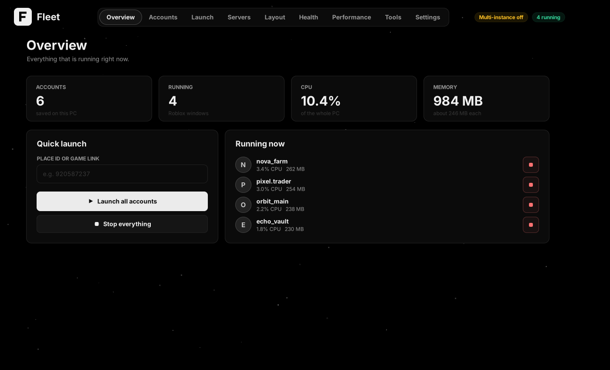
  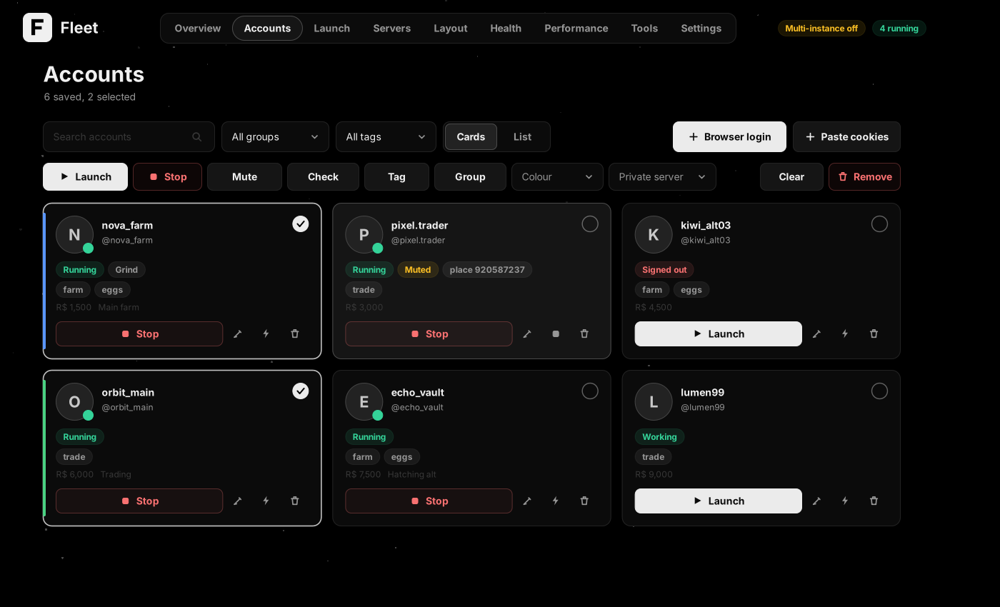
</p>


## Contents

- [Getting started](#getting-started)
- [Features](#features)
- [Screenshots](#screenshots)
- [Build from source](#build-from-source)
- [Safety and privacy](#safety-and-privacy)

## Getting started

1. Download `Fleet.exe` from the Releases page and run it. Nothing needs to be installed.
2. The first-run setup asks for your language, whether to turn multi-instance on, how heavy each Roblox window may be, where to keep your data, and how to add your first account.
3. Add accounts with **Browser login** (Fleet opens Edge or Chrome, you log in, it reads the login for you) or **Paste cookies**.
4. Select accounts on their cards, open **Launch**, pick a game and press **Launch**.
5. Use **Layout** to tile the windows.

Close all Roblox windows before turning multi-instance on. The exe is not code-signed, so Windows SmartScreen may warn the first time.

## Features

**Accounts**
- Cards or a list, search, groups, tags, colours, notes, aliases and saved passwords
- Live status, a Robux balance, and a mute switch per account
- Click an account's picture to see its 3D avatar from Roblox: drag to turn, scroll to zoom
- A details view with account age, Premium, friends and followers
- Import from other managers (JSON, text or `user:pass:cookie` lists)
- Bulk actions on the selected accounts: launch, stop, mute, tag, group, colour, private server, check, remove
- Real text fields: caret movement, selection, copy and paste, undo, a right-click menu and input for any language
- Account tools: summary, quick selection, sort, bulk rename, bulk edit, duplicate finder and export of the selected accounts
- Move everything to another PC as one password-protected file

**Launching**
- Join a game, an exact server, a private server, or follow a player
- Search a game by name, recent places, and a public server browser (fewest players, best ping, random)
- Start every account at the same moment, or a fraction of a second apart. Login tickets are fetched in parallel and every window is found with one shared detector
- Auto-relaunch watcher that rejoins the same server, with a crash breaker
- Roblox version manager: download any recent version, switch the default, delete old ones, or give single accounts their own version
- A cookie refresh option

**Private servers**
- Saved named private servers, assigned per account or to a whole selection
- Link check and one-click launch of everyone on a server

**Health**
- Which logins work, which are signed out or locked, crashes in the last 7 days, and what to do
- Event log with CSV export, quiet automatic checks, one-click recovery

**Performance**
- Frame rate limit and graphics presets, process priority, CPU and memory limits per window
- Slow down windows you are not using, anti-AFK, per-window memory trim
- A whole-PC memory cleaner (working sets, modified and standby lists), manual or automatic
- Quick configs from Ultimate performance to Best visuals, plus community configs
- Shareable `.fcfg` configs that never contain accounts, cookies or servers

**Windows and tools**
- Windows arrange themselves: a grid that fits the screen shape with no gaps, spread over one or all screens, and it rearranges itself when a window opens or closes
- Presets that restore accounts, game and layout, optionally at startup
- A scheduler: launch a preset or everyone, or stop everything, at set times and days
- A command line that covers everything the window does (`fleetctl`, see below) and `fleet://` links
- A gallery of shared configs and themes you can install from inside the app (`gallery/` in this repo, pull requests welcome)
- Extra backup copies to a folder of your choice (needs a password) and keyboard shortcuts
- Macro recorder (record and replay mouse and keyboard)
- Mini window launcher, compact mode, tray icon, global hotkeys, Windows notifications
- Discord webhook alerts and Rich Presence, proxies per account (one each or several accounts per proxy)
- An experimental option to start Roblox with the account's proxy in its environment

**Look**
- Eight black and four light themes, your own colour schemes (import and export), six accent colours
- Smooth animations (page slides, staggered cards, count-up numbers, toasts, pulsing running dots) that stay light on the CPU: the interface is cached and only redrawn when it changes, the background moves at a low frame rate, and everything pauses when Fleet is in the background or on battery. Choose Efficient, Smooth or Minimal
- Ten languages: Spanish, Portuguese, French, German, Italian, Turkish, Russian, Polish, Indonesian and Dutch

**Data**
- Accounts encrypted with Windows, or with your own password
- Portable mode in a `FleetData` folder next to the exe
- Automatic backups and restore, and an updater that checks the SHA-256 before installing

## Command line

`fleetctl.exe` sits next to `Fleet.exe`. It sends the command to the running Fleet (and starts Fleet minimized if it is not running), prints the answer and returns an exit code, so scripts can use it. `Fleet.exe <command>` works the same way, but a terminal does not wait for it, so use `fleetctl` in scripts. Add `--json` to any listing for machine readable output. Exit codes: 0 fine, 1 the command failed, 2 timed out, 4 could not reach Fleet.

```
fleetctl help                      every command
fleetctl help account              the commands of one group
fleetctl launch nova_farm --place 920587237 --wait
fleetctl launch --group Farm --private "https://www.roblox.com/games/920587237/x?privateServerLinkCode=abc"
fleetctl stop --all
fleetctl account list --json
fleetctl config set FpsCap 30
```

| Group | What it covers |
|---|---|
| `launch`, `stop`, `restart`, `running` | start accounts by name, group, tag or all, into a place, a server, a private server or a friend; close them |
| `account ...` | list, info, add (cookie, file, stdin or another manager's export), remove, set fields, tags, mute, check logins, Robux, details, refresh cookie, sort, rename, import, export |
| `server ...`, `preset ...` | saved private servers (add, assign, check, public list) and presets (save, run, delete) |
| `layout ...` | arrange now, screens and Roblox's smallest size |
| `health ...` | login checks, the crash and kick journal, csv export |
| `config ...`, `theme ...`, `perf ...`, `multi` | every setting by its name (`config list`), themes, frame rate, graphics, priority, one click configs, memory trimming |
| `optimizer ...`, `roblox ...` | the Roblox optimizer, the Roblox folder, downloading, deleting and choosing versions |
| `schedule ...`, `macro ...`, `proxy ...`, `webhook test` | scheduled actions, the macro recorder, proxies, the Discord webhook |
| `backup ...`, `gallery ...`, `update ...`, `data path` | backups, shared configs and themes, updates |
| `status`, `log`, `show`, `hide`, `mini`, `quit`, `version` | the app itself |

The older `Fleet.exe --launch NAME --place ID`, `--launch-preset`, `--launch-all`, `--stop-all` and `fleet://` links still work.

## Screenshots

<p align="center">
  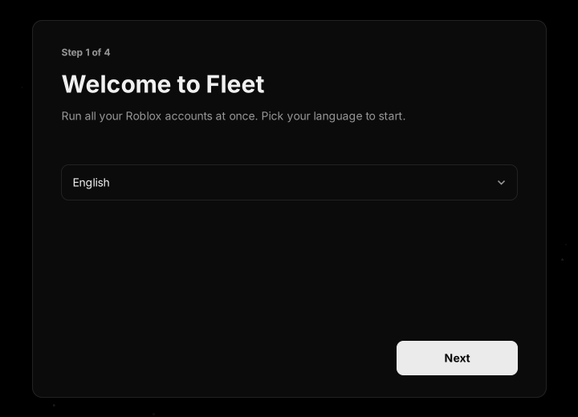
  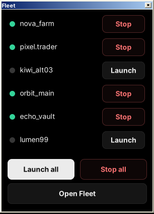
</p>
<p align="center">
  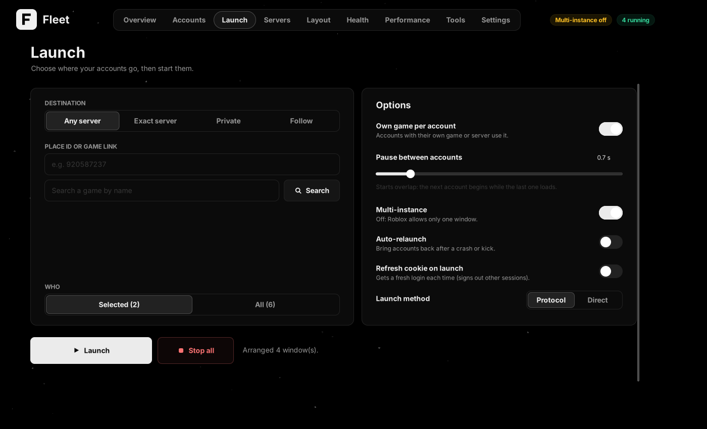
  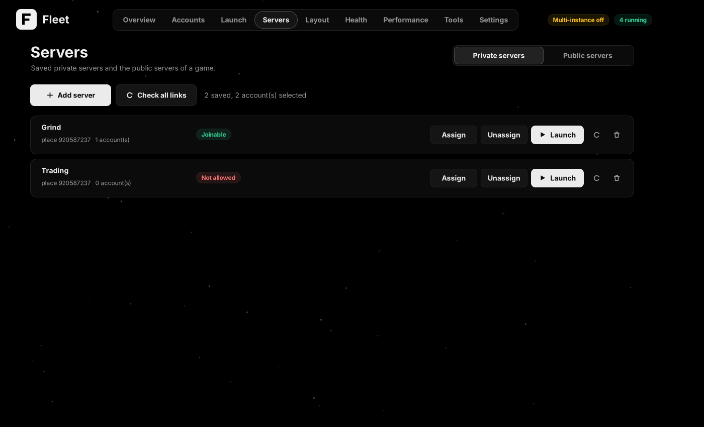
</p>
<p align="center">
  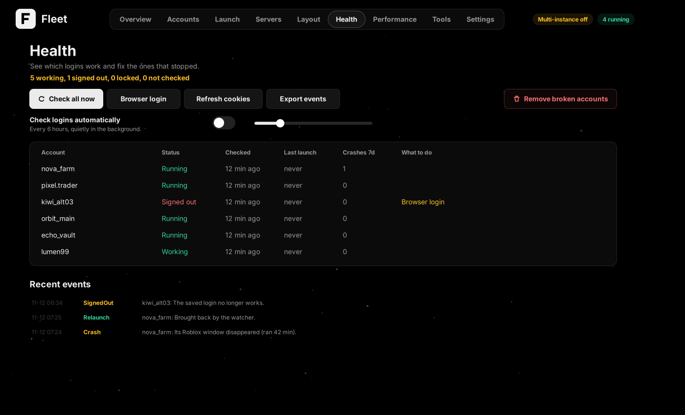
  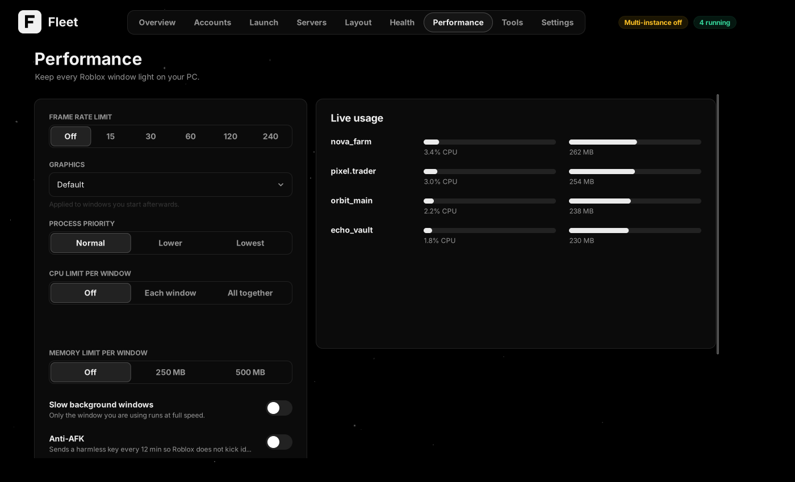
</p>
<p align="center">
  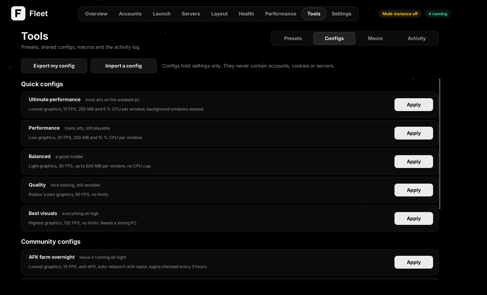
  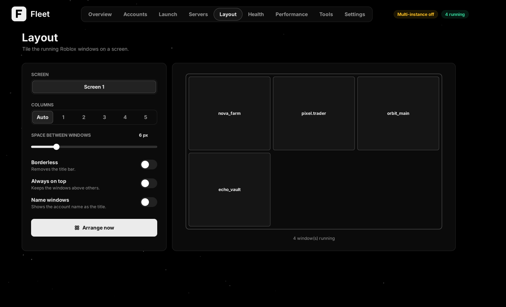
</p>
<p align="center">
  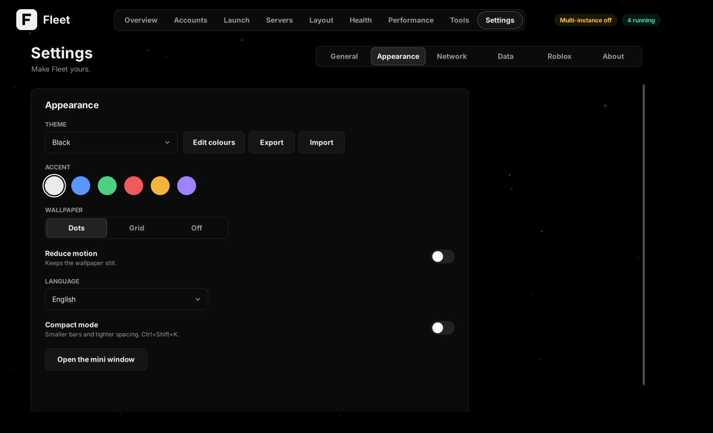
  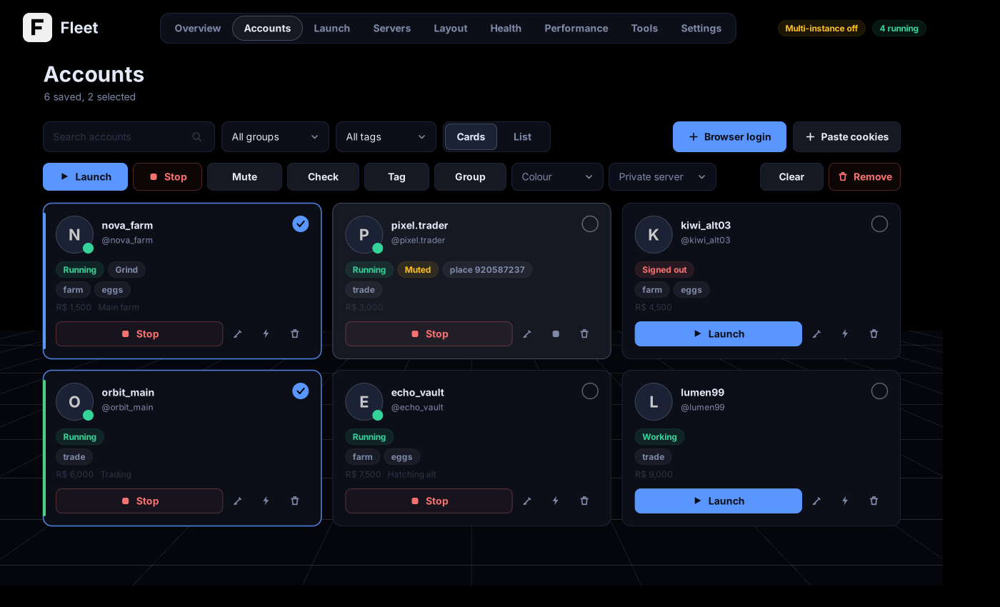
</p>
<p align="center">
  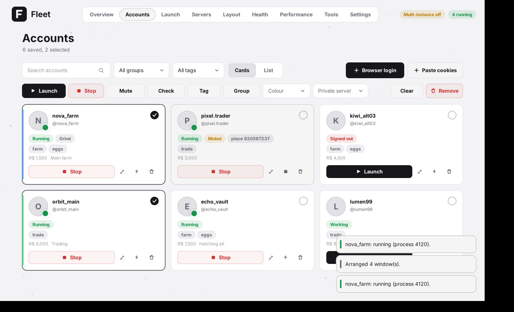
</p>

<sub>The screenshots use made-up accounts.</sub>

## Build from source

You need Windows 10 or 11. The C# compiler is already part of Windows.

```bat
build.bat
```

That compiles `Fleet.exe` in a few seconds and starts it. Pass `nostart` to only build. The code is plain C# on .NET Framework 4 with no packages, and everything on screen is drawn with GDI+ in one control (see `src/Ui.cs`).

## Safety and privacy

- Accounts are encrypted and stay on your PC, in `%AppData%\Fleet` or the `FleetData` folder in portable mode.
- Fleet talks only to Roblox (and to GitHub for update checks). Cookies go only to roblox.com.
- Nothing is injected into Roblox. Multi-instance works by holding Roblox's single-instance lock.
- Roblox can change its client at any time, and running several clients may be against its rules. Use Fleet at your own risk and with your own accounts.

Fleet is an independent project and is not affiliated with or endorsed by Roblox. MIT licensed, see [LICENSE](LICENSE).
